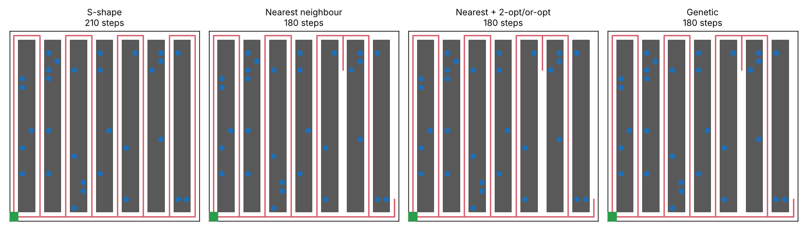
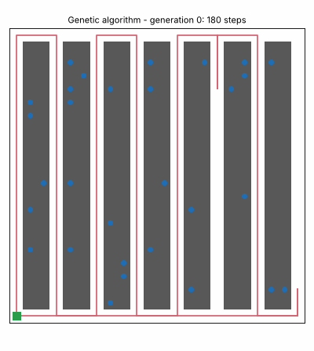

# Warehouse Route Optimizer

[](https://github.com/Paraskevas7/warehouse-route-optimizer/actions)

A picker has to collect 30 items from a warehouse and return to the start. **In which order should they walk?**
This is a travelling-salesman problem on a warehouse floor, and this project solves it with several algorithms and
compares them honestly against the exact optimum.





## What is inside

| Piece | File | Idea |
|---|---|---|
| Warehouse model | `layout.py` | Grid with parallel aisles and shelves; shortest walking paths by breadth-first search |
| Orders + distances | `orders.py` | Random orders (optionally with popular items near the front); distance matrix between picks |
| Heuristics | `algorithms.py` | Random, nearest neighbour, classic **S-shape** warehouse rule |
| Local search | `algorithms.py` | **2-opt** and **or-opt** until no improvement |
| Genetic algorithm | `algorithms.py` | Tournament selection, order crossover (OX), swap/reverse mutation, elitism; optional 2-opt "memetic" step |
| Exact solver | `algorithms.py` | **Held-Karp** dynamic programming over subsets (up to 15 picks) |
| Experiments & plots | `experiments.py`, `viz.py` | Average cost, run time and gap to optimum; route pictures and a GIF |

## Results

Walking distance in steps, averaged over random orders in an 8-aisle, 20-row warehouse (`results/results.md`):

| Algorithm | 10 picks | gap to optimum | 40 picks |
|---|---|---|---|
| Random order | 232.7 | 75.6 % | 843.2 |
| Nearest neighbour | 144.3 | 7.8 % | 212.2 |
| S-shape | 151.8 | 14.1 % | 208.0 |
| Nearest + 2-opt/or-opt | 133.8 | 0.1 % | 203.0 |
| Genetic algorithm | 133.7 | 0.1 % | 203.2 |
| Genetic + 2-opt (memetic) | 133.6 | 0.0 % | 202.0 |
| Exact (Held-Karp) | 133.6 | 0 % | n/a |

What I learned:
- A naive order is about 75 % longer than the best one; a simple rule already removes most of that.
- Cheap local search (2-opt) reaches almost the optimum in milliseconds. The genetic algorithm is about 100-200x slower and
  finds no better answers here, so it is not always the right tool. It helps most when started from good routes.
- The S-shape rule is competitive only when orders are large and spread over most aisles.
- At 40 picks the optimum is out of reach for exact methods, so those rows have no gap column. Differences there are small
  and based on 10 orders, so treat them as indicative, not proof.

## Run it

```bash
pip install -r requirements.txt
python -m unittest discover -s tests          # 18 tests
python -m warehouse_routing solve --picks 30 --algorithm nearest+2opt --plot route.png
python -m warehouse_routing compare --picks 10 --trials 20 --optimal
python -m warehouse_routing animate --out ga.gif
python make_figures.py                          # rebuilds figures and results
```

## Design notes
- Distances come from real shortest paths on the grid, so the model can later get one-way aisles or blocked cells.
- Every algorithm returns a permutation of `1..n`; tests check this, check that local search never makes a route worse,
  and check Held-Karp against brute force over all permutations.
- Runs are seeded, so results are reproducible.

## Ideas to extend
Several pickers (vehicle routing), capacity limits, one-way aisles, order batching, simulated annealing, Or-tools comparison.

## License
MIT
